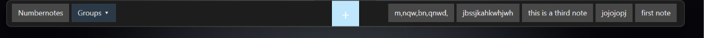

# StickyNotes — auto-hiding sticky notes for Windows

A lightweight sticky-notes app that stays out of the way until you need it. Move your mouse to the **top-centre edge** of a monitor and a bookmark-bar-style strip slides down with your pinned notes, groups, recents, and a quick-capture **+**.

Built with a **Rust core** (SQLite + FFI) and a **C# WPF** UI — no Electron, no WebView, just native windows. ~20–45 MB idle, 0% CPU when hidden.



---

## Features

- **Auto-hide trigger** — a subtle 100×4 notch at the top-centre of each monitor; hover ~180 ms to reveal the bar
- **Pinned rail + Groups ▾ + Recents** — pin notes and groups, browse all groups, jump to recent notes
- **Group lists** — click a group to open its vertical list with `+ New Note` at the top
- **Quick capture (`+`)** — save standalone, into a group, or **append** to an existing note; `Ctrl+Enter` / click-outside commits, `Esc` discards
- **Floating note windows** — click a note to open it beside the list; 350 ms autosave; click-outside gives a 5 s grace period (handy for copy/paste)
- **Inline group management** — create, rename, pin/unpin, delete with an inline confirm (no modal dialogs)
- **Multi-monitor & DPI aware** — PerMonitorV2, correct placement across mixed DPI and negative-coordinate monitors
- **Tray app** — no taskbar or Alt+Tab entries; tray icon → Exit
- **Single instance** — launching a second copy exits cleanly

---

## Download

Download **StickyNotes-0.1.0-win-x64.zip** from the [Releases](../../releases) page (or build it yourself with `scripts\package.ps1`). The ZIP is a **self-contained win-x64 build** — testers do **not** need .NET or Rust installed.

### Run without installing
1. Extract the ZIP.
2. Double-click `StickyNotes.App.exe`.
3. Look for the StickyNotes icon in the system tray (click `^` if it's hidden).

### Install (optional)
```powershell
powershell -ExecutionPolicy Bypass -File .\install.ps1
```
Adds a Start Menu shortcut and an Add/Remove Programs entry (per-user, no admin). Uninstall with `.\uninstall.ps1` — your notes are kept unless you pass `-PurgeData`.

---

## How to use

| Action | How |
| --- | --- |
| Show the bar | Move the mouse to the top-centre edge of a monitor and hold ~0.2 s |
| Open a group | Click a group chip (or `Groups ▾` → group) |
| Quick note | Click `+` → type → `Ctrl+Enter` / click outside to save, `Esc` to discard |
| New note in a group | Open a group → `+ New Note` |
| Pin / unpin | Right-click a chip |
| Open a note | Click it in the bar or a group list |
| Exit | Right-click the tray icon → Exit |

Data lives in `%LOCALAPPDATA%\StickyNotes\sticky.db` (SQLite). Delete it to reset.

---

## Build from source

**Prerequisites:** Windows 10 21H2+ / 11 (x64) · Rust 1.80+ (MSVC) · .NET SDK 8 · VS 2022 C++ Build Tools

```powershell
# Build everything (Rust core + C# UI) and stage the native dll
powershell -ExecutionPolicy Bypass -File .\scripts\build.ps1

# Run all automated tests (54 Rust + 77 C# = 131)
powershell -ExecutionPolicy Bypass -File .\scripts\test.ps1

# Build a distributable ZIP -> dist\StickyNotes-<version>-win-x64.zip
powershell -ExecutionPolicy Bypass -File .\scripts\package.ps1
```

Per-task gate (runs every automated test for tasks 1..N, so earlier work can't silently break):
```powershell
powershell -ExecutionPolicy Bypass -File .\scripts\gate.ps1 -Task N
```

---

## Architecture

```text
crates/sticky-core/     Rust: SQLite schema/CRUD, pin & recents ordering, quick-capture routing, extern "C" FFI
win/StickyNotes.App/    C# WPF: trigger / bar / group-list / note / quick-note windows, Win32 interop, DPI math
win/StickyNotes.Tests/  xUnit: FFI round-trips, positioning, state machines, session logic
scripts/                build / test / package / gate
docs/                   manual acceptance checklist + testing map
```

- **Boundary:** hand-written `extern "C"` ABI + UTF-8 JSON DTOs (16 functions)
- **Idle cost:** 0% CPU when hidden (no active timers), < 50 MB working set
- **Tests:** 131 automated (54 Rust + 77 C#); focus/window behaviour is covered by the manual checklist

See [`docs/TESTING.md`](docs/TESTING.md) for the task-by-task test/gate map.

---

## Roadmap

**v1.0** (this release) — everything above.

**v0.2.0** — planned; see [`docs/ROADMAP-v0.2.0.md`](docs/ROADMAP-v0.2.0.md) for the full spec:
- Move an existing note into a new/existing group
- Explicit note titles
- Larger hover target (test-safe approach)
- Hover a note to preview it
- Hover a group to open its list (revisits the click-to-open design)

**Out of scope:** active-window detection / context-aware bar, app-directory mapping, macOS UI, cloud sync, search UI.

---

## Known limitations

- Fullscreen suppression uses `SHQueryUserNotificationState` + a caption-less-borderless heuristic; some windowed video with a caption may not suppress the bar.
- `AttachThreadInput` is blocked by UIPI against elevated windows — click inside an editor to activate it there.
- Windows only.
- Binaries are unsigned — SmartScreen may warn on first run (More info → Run anyway).

---

## License

MIT — see [LICENSE](LICENSE).